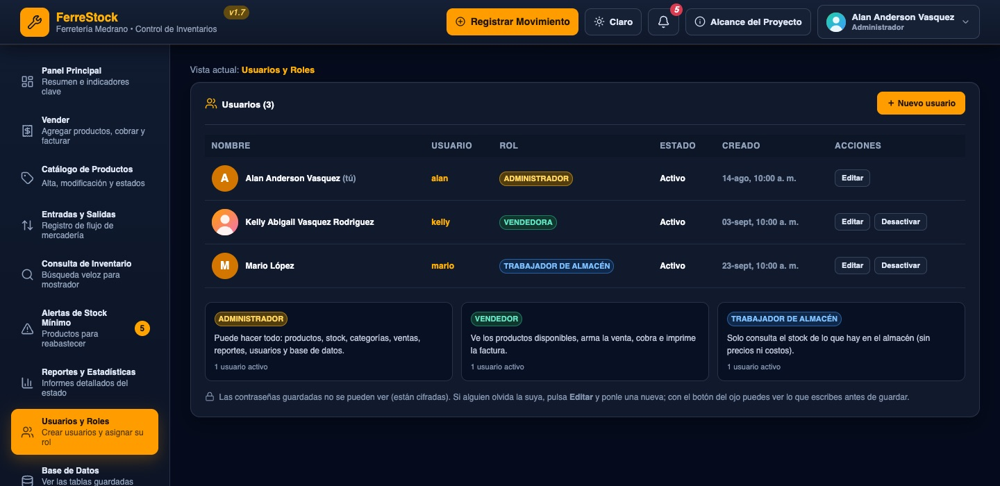
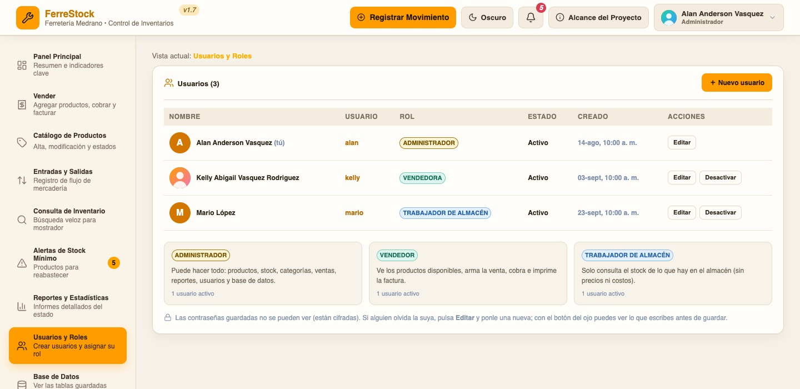
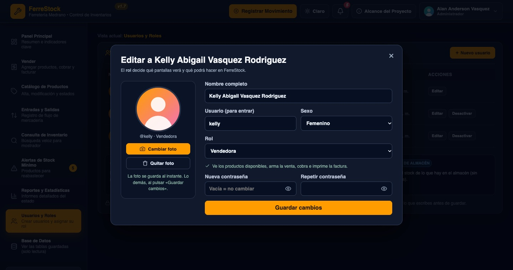
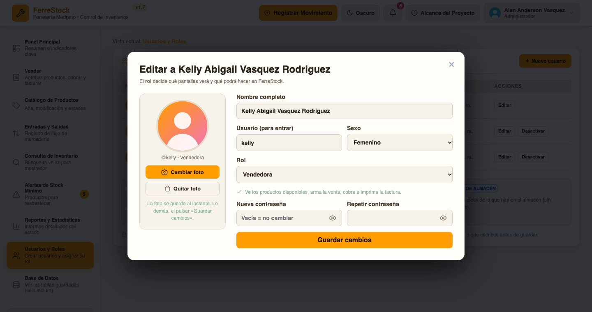
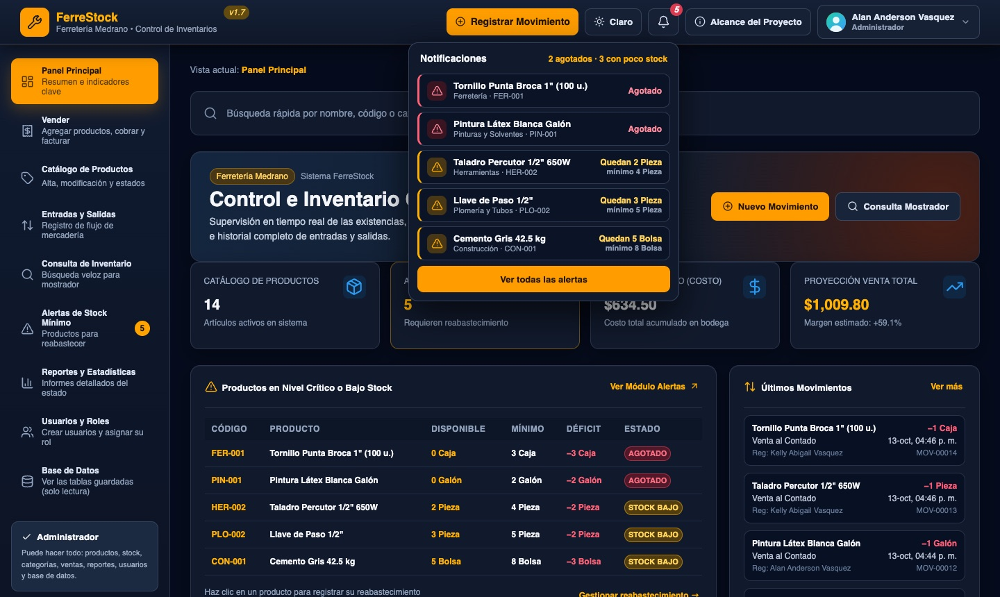
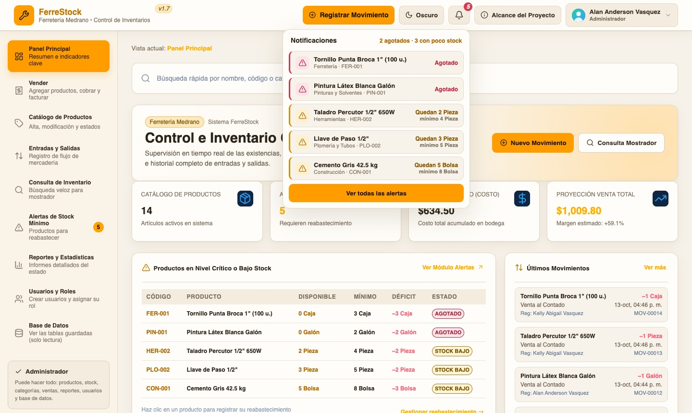
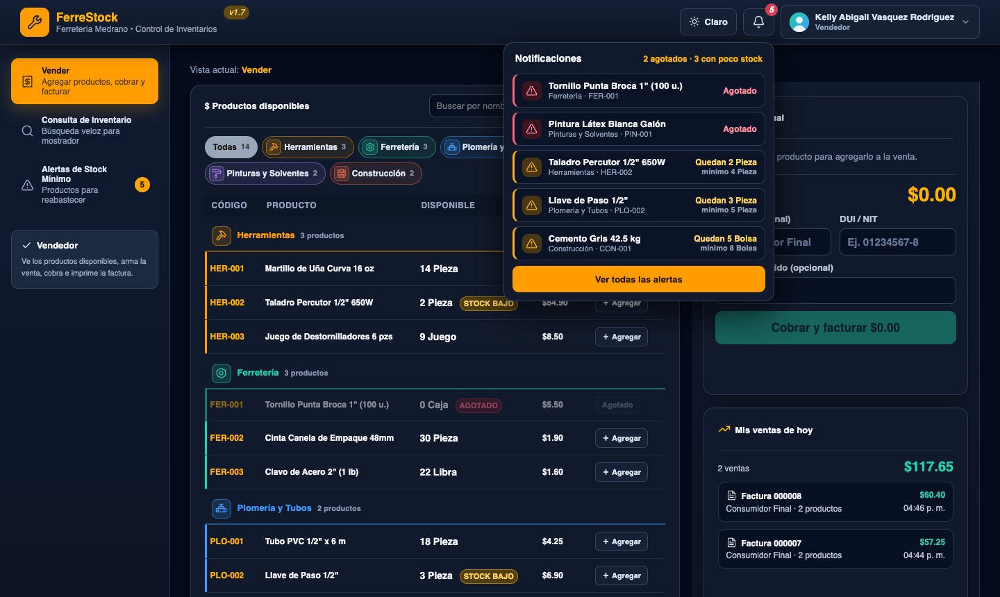

# FerreStock · Documentación completa

Todo lo que hay que saber de FerreStock en **un solo archivo**: cómo se abre, cómo está hecho por dentro, cómo se publica en internet y qué cambió en cada versión.

| | |
|---|---|
| **Versión actual** | 1.7.0 |
| **Portada del proyecto** | [`README.md`](../README.md) |

## Índice

1. [Parte 1. Primeros pasos](#parte-1-primeros-pasos): instalar, configurar y abrir el programa.
2. [Parte 2. Guía técnica del código](#parte-2-guía-técnica-del-código): arquitectura, estructura de archivos, base de datos, API, roles y dónde hacer cada cambio.
3. [Parte 3. Publicar en Google Cloud Run](#parte-3-publicar-en-google-cloud-run): link público, actualización automática desde GitHub y cómo apagarlo.
4. [Parte 4. Historial de versiones](#parte-4-historial-de-versiones): qué cambió en cada versión, con capturas del antes y el después.

---

## Parte 1. Primeros pasos

### Requisitos

- **Node.js 22.13 o superior** y conexión a Internet.
- Un archivo **`.env.local`** en la carpeta del proyecto con los datos de tu base de Supabase (ver abajo).

### Instalar y abrir

```bash
npm install     # una sola vez: descarga las dependencias
npm run dev     # abre FerreStock en http://127.0.0.1:5173
```

En VS Code también puedes pulsar **⇧⌘B** (Mac) para abrirlo. Para detenerlo, pulsa **Ctrl + C** en la terminal; cerrar la pestaña del navegador no lo detiene.

La primera vez que se abre sin usuarios, el sistema te guía para crear al **administrador**. Después, inicia sesión con tu usuario y contraseña de FerreStock (no son las de la base de datos).

### Configuración (`.env.local`)

El archivo se llama **`.env.local`** (el nombre empieza con punto):

```
PGHOST=
PGPORT=5432
PGDATABASE=postgres
PGUSER=
PGPASSWORD=
```

> ⚠️ Este archivo contiene la contraseña de tu base de datos. **No lo compartas ni lo subas a GitHub.** El `.gitignore` ya lo excluye; si tu archivo se llama `env.local` (sin punto) también queda excluido.
> Si la contraseña tiene símbolos raros, escríbela entre comillas.

### Comandos

| Comando | Qué hace |
|---|---|
| `npm run dev` | Abre el programa en modo desarrollo |
| `npm run build` | Compila la interfaz en `dist/` |
| `npm run preview` | Sirve la versión compilada junto con el servidor |
| `npm start` | Servidor de producción (el que usa la nube); requiere `npm run build` antes |

### Notas importantes

- Las facturas son un **comprobante interno**: no son Documentos Tributarios Electrónicos (DTE) certificados por Hacienda.
- Los respaldos de datos se hacen desde PostgreSQL/Supabase.
- No uses dos versiones del programa a la vez para registrar operaciones sobre la misma base.
- La base de datos es **la misma** para tu computadora y para el link público: una venta registrada en uno aparece en el otro.

---

## Parte 2. Guía técnica del código

Sistema de inventario y ventas para ferretería. Esta parte documenta su arquitectura, estructura, modelo de datos, API, permisos y dónde modificar cada comportamiento. Está escrita para poder leerse sin experiencia previa en programación; los términos técnicos se explican en el [glosario](#10-glosario).

| | |
|---|---|
| **Versión** | 1.7.0 |
| **Interfaz** | React 19 + Vite 8 |
| **Servidor** | Node.js ≥ 22.13 (middleware de Vite, sin framework adicional) |
| **Base de datos** | PostgreSQL alojado en Supabase (`pg` 8) |
| **Idioma del código** | Español (nombres de archivos, funciones y textos) |

### Contenido

1. [Arquitectura](#1-arquitectura)
2. [Puesta en marcha](#2-puesta-en-marcha)
3. [Estructura del proyecto](#3-estructura-del-proyecto)
4. [Modelo de datos](#4-modelo-de-datos)
5. [Referencia de la API](#5-referencia-de-la-api)
6. [Roles y permisos](#6-roles-y-permisos)
7. [Flujo de ejemplo: cobrar una venta](#7-flujo-de-ejemplo-cobrar-una-venta)
8. [Seguridad y consistencia de datos](#8-seguridad-y-consistencia-de-datos)
9. [Guía de cambios frecuentes](#9-guía-de-cambios-frecuentes)
10. [Glosario](#10-glosario)

---

### 1. Arquitectura

FerreStock se divide en **tres capas**. Cada una solo habla con la siguiente:

```
┌────────────────────┐      ┌───────────────────────┐      ┌──────────────────────┐
│  INTERFAZ  (src/)  │ ───► │  SERVIDOR (servidor/) │ ───► │  BASE DE DATOS       │
│  React, navegador  │ /api │  reglas y permisos    │  SQL │  PostgreSQL/Supabase │
│  "el mostrador"    │ ◄─── │  "el encargado"       │ ◄─── │  "la bodega"         │
└────────────────────┘      └───────────────────────┘      └──────────────────────┘
```

- La interfaz **nunca** accede a la base de datos. Todo pasa por el servidor, que valida permisos y reglas del negocio (por ejemplo, que no se venda más stock del que existe).
- Las credenciales de la base viven solo en `.env.local`, que lee el servidor. El navegador nunca las recibe.
- En desarrollo, un único proceso (Vite) sirve la interfaz y atiende las peticiones `/api`, tal como lo configura `vite.config.js`.

#### Cómo se conectan los módulos

```
index.html ─► src/main.jsx ─► src/App.jsx ─┬─► pantallas/Ingreso.jsx          (sin sesión)
                                           └─► src/Sistema.jsx                (con sesión)
                                                  ├─► pantallas/*  ─► ventanas/*  ─► componentes/*
                                                  └─► utilidades/servidor.js ──── /api ────┐
                                                                                           ▼
 vite.config.js ──────────────────────────────────────────────────────────────►  servidor/api.js
                                                                                           │
                          ┌────────────────────┬──────────────────┬────────────────────┐   │
                          ▼                    ▼                  ▼                    ▼   ▼
                    acceso/              inventario/          ventas/             basedatos/
               roles · sesiones      productos · categorias   ventas · negocio    postgres (Supabase)
               usuarios · seguridad  movimientos · motivos                        transaccion · visor
```

---

### 2. Puesta en marcha

**Requisitos:** Node.js ≥ 22.13, conexión a Internet y un archivo `.env.local` en la raíz.

```bash
npm install      # una sola vez: descarga las dependencias
npm run dev      # inicia el programa en http://127.0.0.1:5173
```

En VS Code también se puede usar **⇧⌘B** (tarea `FerreStock`, definida en `.vscode/tasks.json`).

| Comando | Qué hace |
|---|---|
| `npm run dev` | Modo desarrollo. Los cambios en `src/` se ven al instante; los de `servidor/` requieren reiniciar (Ctrl + C y volver a ejecutar). |
| `npm run build` | Compila la interfaz en `dist/` (carpeta generada, no se edita). |
| `npm run preview` | Sirve la versión compilada junto con el servidor. |

**Contenido de `.env.local`** (archivo secreto, nunca se sube a un repositorio público):

| Variable | Descripción |
|---|---|
| `PGHOST` · `PGPORT` | Dirección y puerto del servidor de Supabase (pooler). |
| `PGDATABASE` | Nombre de la base (normalmente `postgres`). |
| `PGUSER` | Usuario técnico de la base de datos (no es un usuario de FerreStock). |
| `PGPASSWORD` | Contraseña de la base de datos. |

---

### 3. Estructura del proyecto

★ marca los archivos que con más probabilidad se modificarán.

#### 3.1 Raíz

| Archivo / carpeta | Función |
|---|---|
| `.env.local` | Credenciales de conexión a Supabase. |
| `package.json` · `package-lock.json` | Dependencias, versiones exactas y comandos `npm run …`. |
| `vite.config.js` | Conecta la interfaz con el servidor: las rutas `/api` se atienden con `servidor/api.js`. |
| `index.html` | Página vacía donde React dibuja la aplicación. |
| `README.md` · `docs/DOCUMENTACION.md` | Documentación: la portada (en la raíz) y el manual completo (primeros pasos, guía técnica, publicación en Google Cloud Run e historial de versiones). |
| `Dockerfile` · `.dockerignore` · `.gcloudignore` | Empaquetado para la nube. Excluyen siempre `.env.local`. |
| `scripts/desplegar-en-cloud-run.sh` | Publica FerreStock en Google Cloud Run con un comando. |
| `docs/versiones/` | Capturas de pantalla (antes y después) que usa el historial de versiones (Parte 4). Se tomaron con datos de ejemplo. |
| `.gitignore` · `.gitattributes` | Reglas de git: qué no se sube y cómo se normalizan los saltos de línea. |
| `.vscode/tasks.json` | Tarea `FerreStock` para VS Code. |
| `node_modules/` | Dependencias descargadas; se regenera con `npm install`. No se edita. |

#### 3.2 `servidor/` — lógica y acceso a datos

| Carpeta | Archivo | Responsabilidad |
|---|---|---|
| (raíz) | `api.js` ★ | Tabla de rutas: qué petición se acepta, **quién** puede hacerla y qué función la atiende. |
| (raíz) | `produccion.js` | Servidor para la nube (`npm start`): sirve las pantallas compiladas y atiende `/api`. En tu computadora esto lo hace Vite. |
| `acceso/` | `roles.js` ★ | Define los roles (administrador, vendedor, trabajador) y su descripción. |
| | `sesiones.js` | Iniciar y cerrar sesión, identificar al usuario de cada petición, primer administrador. |
| | `usuarios.js` | Crear, editar, desactivar y eliminar usuarios; asignar rol. |
| | `seguridad.js` | Cifrado de contraseñas (scrypt) y llaves de sesión. |
| | `perfil.js` | Foto de perfil, ajustes personales y cambio de la propia contraseña. Crea las columnas `foto` y `preferencias` si faltan. |
| `inventario/` | `productos.js` | Crear, editar, activar y desactivar productos; filtra datos según el rol. |
| | `categorias.js` | Crear, renombrar, ordenar y borrar categorías. |
| | `movimientos.js` | Registrar entradas y salidas y actualizar el stock. |
| | `motivos.js` ★ | Lista de motivos de entrada y salida (Venta al Contado, Merma…). |
| `ventas/` | `ventas.js` | Cobrar, consultar y reimprimir facturas, ventas del día y por día. |
| | `negocio.js` | Datos de la ferretería que aparecen en la factura. |
| `basedatos/` | `postgres.js` | Conexión privada a Supabase (TLS con verificación de certificado). |
| | `baseDeDatos.js` | Punto único de acceso a la base para el resto del servidor. |
| | `transaccion.js` | Agrupa varios cambios para que se guarden "todos o ninguno". |
| | `visorDeBase.js` · `vistasConsulta.js` | Alimentan la pantalla *Base de Datos* (solo lectura). |
| | `supabase-ca.crt` | Certificado oficial para comprobar que la conexión es realmente con Supabase. |
| `comun/` | `http.js` | Lectura de peticiones, respuestas, cookies y códigos de error. |

#### 3.3 `src/` — interfaz

| Carpeta / archivo | Contenido |
|---|---|
| `main.jsx` | Punto de arranque del navegador. |
| `App.jsx` | Decide entre pantalla de ingreso y programa, según haya sesión. |
| `Sistema.jsx` ★ | Marco general: barra superior, menú según el rol, buscador y bienvenida. |
| `estilos.css` ★ | Colores, tamaños y posiciones de toda la interfaz. |
| **`pantallas/`** | Una por cada opción del menú (ver tabla siguiente). |
| **`ventanas/`** | Ventanas emergentes y formularios (incluye `AjustesDeUsuario.jsx`, los ajustes de cuenta de cada persona). |
| **`componentes/`** | Piezas reutilizables sin lógica de negocio. |
| **`utilidades/`** | Funciones compartidas: comunicación con el servidor, cálculos y formato. |

**Pantallas** (cada una se conecta al servidor mediante `utilidades/servidor.js`):

| Pantalla | Rol | Función |
|---|---|---|
| `Ingreso.jsx` | Público | Usuario y contraseña; creación del primer administrador. |
| `PanelPrincipal.jsx` | Admin | Resumen general e indicadores. |
| `Vender.jsx` | Admin · Vendedor | Caja: armar la venta, cobrar y facturar. |
| `Almacen.jsx` | Trabajador | Stock por categoría, sin precios ni costos. |
| `Catalogo.jsx` | Admin | Alta, edición y estado de productos; administración de categorías. |
| `EntradasYSalidas.jsx` | Admin | Historial de movimientos con filtros. |
| `Consulta.jsx` | Admin · Vendedor | Búsqueda rápida de productos. El vendedor la ve en solo lectura, sin costos y con aviso de poco stock y agotados. |
| `Alertas.jsx` | Admin · Vendedor | Productos bajo el mínimo. El administrador ve el costo de reposición y puede reabastecer; el vendedor solo consulta (sin costos). |
| `Reportes.jsx` | Admin | Estadísticas, ventas por día y reparto del inventario. |
| `Usuarios.jsx` | Admin | Gestión de usuarios y roles. |
| `BaseDeDatos.jsx` | Admin | Visor de tablas y resúmenes (solo lectura). |

**Ventanas:** `FormularioProducto`, `FormularioMovimiento`, `FormularioUsuario`, `FormularioNegocio`, `AdministrarCategorias`, `QuitarUsuario`, `VerFactura` y el ayudante `useGuardar.js` (estado "Guardando…" y errores en los formularios).

**Componentes:** `MenuDeUsuario` (foto + nombre arriba a la derecha, con cambiar foto, ajustes y cerrar sesión), `Avatar`, `Icono`, `Ventana`, `Alerta`, `CampoClave`, `Factura`, `GraficaDeBarras`, `GraficaDeCirculo`, `IconoDeArea`, `EtiquetaEstado`, `FilasPorCategoria`, `FilaVacia`, `TarjetaMovimiento`.

**Utilidades:** `foto.js` (recorta y reduce la foto de perfil a 256 × 256 px), `servidor.js` (peticiones a `/api`), `useInventario.js` (carga y refresca productos y movimientos), `calculos.js` (alertas, totales, búsquedas), `areas.js` ★ (ícono y color por categoría), `formato.js` (moneda, cantidades y fechas).

---

### 4. Modelo de datos

La base tiene **8 tablas**. Las relaciones se indican con `→`.

| Tabla | Descripción | Columnas principales |
|---|---|---|
| `categorias` | Categorías de productos y su orden en pantalla. | `id`, `nombre`, `orden` |
| `productos` | Catálogo con stock, costo y precio. | `id`, `codigo`, `nombre`, `categoria_id → categorias`, `unidad`, `stock`, `minimo`, `costo`, `precio`, `activo` |
| `movimientos` | Cada entrada o salida de mercadería. | `id`, `producto_id → productos`, `tipo`, `motivo`, `cantidad`, `usuario`, `nota`, `fecha`, `venta_id → ventas`, `precio_unitario` |
| `ventas` | Una fila por cobro (cada una es una factura). | `id`, `usuario_id → usuarios`, `total`, `recibido`, `cambio`, `fecha`, `cliente`, `cliente_documento` |
| `usuarios` | Personas que pueden entrar al sistema. | `id`, `usuario`, `nombre`, `rol → roles`, `clave_hash`, `clave_sal`, `activo`, `creado`, `eliminado`, `foto`, `preferencias`, `sexo` |
| `roles` | Tipos de usuario y su descripción. | `clave`, `nombre`, `descripcion`, `orden` |
| `sesiones` | Sesiones abiertas; guarda solo el *hash* de la llave. | `token_hash`, `usuario_id → usuarios`, `expira` |
| `negocio` | Datos de la ferretería para la factura (una sola fila). | `nombre`, `direccion`, `telefono`, `documento`, `mensaje` |

```
categorias ◄── productos ◄── movimientos ──► ventas ──► usuarios ──► roles
                                                           ▲
                                                       sesiones
```

La pantalla *Base de Datos* muestra además resúmenes calculados (`productos_por_categoria`, `inventario_por_categoria`, `movimientos_detalle`, `ventas_detalle`, `usuarios_detalle`), definidos en `servidor/basedatos/vistasConsulta.js`. Son solo de lectura.

---

### 5. Referencia de la API

Todas las rutas empiezan con `/api` y se declaran en `servidor/api.js`. Los métodos significan: `GET` consultar · `POST` crear · `PUT` modificar · `PATCH` cambiar un detalle · `DELETE` borrar.

**Quién puede llamarla:** `Público` (sin sesión) · `Todos` (cualquier usuario con sesión) · `Admin + Vendedor` · `Admin`.

| Método | Ruta | Acceso | Descripción |
|---|---|---|---|
| GET | `/sesion` | Público | Estado de la sesión actual. |
| POST | `/sesion/iniciar` | Público | Iniciar sesión. |
| POST | `/sesion/configurar` | Público | Crear el primer administrador (solo si no hay usuarios). |
| POST | `/sesion/cerrar` | Público | Cerrar sesión. |
| PUT | `/perfil` | Todos | Cambiar la propia foto y los propios ajustes. |
| POST | `/perfil/clave` | Todos | Cambiar la propia contraseña (pide la actual). |
| GET | `/productos` | Todos | Listar productos; cada rol recibe solo los datos que le corresponden. |
| POST | `/ventas` | Admin + Vendedor | Cobrar una venta y generar la factura. |
| GET | `/ventas/hoy` | Admin + Vendedor | Ventas del día (el vendedor ve solo las suyas). |
| GET | `/ventas/:id` | Admin + Vendedor | Ver o reimprimir una factura. |
| GET | `/configuracion` | Admin | Categorías y motivos para los formularios. |
| POST · PUT · DELETE | `/categorias` · `/categorias/:id` | Admin | Crear, renombrar, borrar. |
| POST | `/categorias/:id/mover` | Admin | Subir o bajar una categoría. |
| POST · PUT | `/productos` · `/productos/:id` | Admin | Crear o editar un producto. |
| PATCH | `/productos/:id/activo` | Admin | Activar o desactivar un producto. |
| GET · POST | `/movimientos` | Admin | Listar o registrar entradas y salidas. |
| GET · POST · PUT · DELETE | `/usuarios` · `/usuarios/:id` | Admin | Gestión de usuarios (la lista incluye la foto de cada uno). |
| PUT | `/usuarios/:id/foto` | Admin | Cambiar la foto de otro usuario, o quitarla enviando `null`. |
| GET | `/roles` | Admin | Lista de roles y descripciones. |
| GET | `/reportes/ventas-por-dia?dias=7` | Admin | Ventas agrupadas por día. |
| GET · PUT | `/negocio` | Admin | Datos de la factura. |
| GET | `/base-de-datos` · `/base-de-datos/contenido?nombre=…` | Admin | Visor de solo lectura. |

---

### 6. Roles y permisos

| Capacidad | Trabajador | Vendedor | Administrador |
|---|:---:|:---:|:---:|
| Ver stock de cada producto | ✅ (*Stock del Almacén*) | ✅ (en *Vender*) | ✅ |
| Ver precio de venta | ❌ | ✅ | ✅ |
| Consultar el inventario con avisos de poco stock y agotados | ✅ (*Stock del Almacén*) | ✅ (*Consulta* y *Alertas*, solo lectura) | ✅ (*Alertas*) |
| Ver las notificaciones de stock en la campanita y recibir el aviso cuando algo se agota | ❌ | ✅ | ✅ |
| Ver costo de los productos | ❌ | ❌ | ✅ |
| Cobrar e imprimir facturas | ❌ | ✅ | ✅ |
| Ver o reimprimir facturas del día | ❌ | ✅ (las suyas) | ✅ (todas) |
| Crear/editar productos, categorías y entradas de stock | ❌ | ❌ | ✅ |
| Alertas, reportes, historial y base de datos | ❌ | ❌ | ✅ |
| Crear usuarios, asignar roles, cambiar contraseñas, desactivar o eliminar | ❌ | ❌ | ✅ |
| Ver, cambiar o quitar la foto de perfil de otros usuarios | ❌ | ❌ | ✅ |
| Cambiar los datos de la factura | ❌ | ❌ | ✅ |

**Perfil y ajustes personales (todos los roles)**
- Al pulsar el nombre arriba a la derecha se abre un menú con **Cambiar foto de perfil**, **Ajustes de mi cuenta** y **Cerrar sesión**.
- La foto se recorta y se reduce en el navegador (256 × 256 px) y se guarda en la columna `usuarios.foto`.
- Los ajustes se guardan en `usuarios.preferencias` y acompañan a la persona en cualquier computadora: **tema** claro u oscuro, **menú compacto**, **pantalla de inicio**, y **mostrar la bienvenida**.
- Cada persona puede cambiar **su propia contraseña** (pide la actual y cierra sus otras sesiones).
- Nadie puede modificar el perfil de otra persona desde ahí: el servidor siempre usa el usuario de la sesión.
- **El administrador sí puede ver, cambiar o quitar la foto de cualquier usuario**: la ve en la lista de *Usuarios y Roles* y la gestiona en la ventana **Editar** (panel de foto al costado del formulario; también se abre al pulsar la foto). Quitarla pide una confirmación. El servidor solo acepta ese cambio de un administrador: un vendedor recibe 403.
- **El sexo de cada persona** (femenino o masculino) se pide al crear o editar un usuario, y decide cómo se llama su rol: *Administradora*, *Vendedora* o *Trabajadora de almacén* si es mujer; *Administrador*, *Vendedor* o *Trabajador de almacén* si es hombre. Se ve en el menú de usuario, la bienvenida, la lista de usuarios y los ajustes. Las personas que aún no tienen el dato siguen en masculino hasta que se les edite.

**Gestión de usuarios**
- La primera vez que se abre el programa no hay usuarios: aparece *Configuración inicial* para crear al administrador.
- Solo el administrador crea usuarios y asigna roles (menú **Usuarios y Roles**).
- **Desactivar:** el usuario no puede entrar, pero sigue en la lista y puede reactivarse.
- **Eliminar:** desaparece de la lista. Si nunca vendió, se borra por completo; si ya tiene ventas, queda marcado como *eliminado* únicamente para que sus facturas conserven su nombre. Su nombre de usuario queda libre.
- Nadie puede desactivarse ni eliminarse a sí mismo, y siempre debe quedar al menos un administrador activo.
- **Contraseña olvidada:** el administrador asigna una nueva en *Usuarios → Editar*. Conviene tener dos administradores.

**Dónde se aplican los permisos:** en el servidor (`servidor/api.js`, columna "quién"), no solo en la interfaz. Aunque alguien lograra ver un botón que no le corresponde, el servidor rechazaría la petición. `roles.js` contiene la descripción de cada rol, pero **cambiarla no modifica los permisos reales**.

---

### 7. Flujo de ejemplo: cobrar una venta

1. En **Vender** (`src/pantallas/Vender.jsx`), el vendedor selecciona productos (con clic o escribiendo el código y pulsando Enter). Se acumulan en la *Venta actual* con su total.
2. Opcionalmente indica el cliente (nombre y DUI/NIT; si no, la factura dice *Consumidor Final*) y el efectivo recibido; la pantalla calcula el **cambio**. Luego pulsa **Cobrar y facturar**.
3. `src/utilidades/servidor.js` envía al servidor `POST /api/ventas` con los productos, las cantidades y los datos del cliente.
4. `servidor/api.js` verifica que el rol pueda cobrar y llama a `cobrarVenta` en `servidor/ventas/ventas.js`, que:
   - comprueba que haya stock de todo y calcula el total con los **precios guardados en la base** (no con los que muestra la pantalla);
   - guarda la venta, una salida por cada producto (con el nombre del vendedor) y descuenta el stock, **todo junto o nada** (`servidor/basedatos/transaccion.js`);
   - devuelve la factura completa: venta, productos y datos del negocio (`servidor/ventas/negocio.js`).
5. Se abre la factura (`src/ventanas/VerFactura.jsx`). **Imprimir** envía a la impresora solo la hoja de la factura; el resto de la pantalla se oculta (sección de impresión de `estilos.css`). También permite *Guardar como PDF*.
6. La factura queda en *Mis ventas de hoy* y puede reimprimirse.

> **Importante:** la factura es un comprobante interno. **No** es un Documento Tributario Electrónico (DTE) certificado por Hacienda. Si el negocio necesita emitir DTE, debe hacerlo con el sistema de Hacienda o con un proveedor autorizado.

---

### 8. Seguridad y consistencia de datos

| Aspecto | Cómo se resuelve |
|---|---|
| Contraseñas de usuarios | Se guardan cifradas con **scrypt** y sal individual (`clave_hash`, `clave_sal`). No se pueden recuperar, ni siquiera abriendo la base. |
| Intentos fallidos | Tras 5 contraseñas incorrectas seguidas, el usuario debe esperar 1 minuto. |
| Sesiones | Duran 12 horas. En la base solo se guarda el *hash* de la llave; el navegador la recibe en una cookie. |
| Permisos | Se validan en el servidor en cada petición y se revalidan antes de escribir. |
| Credenciales de la base | Solo en `.env.local`; el navegador nunca las recibe. Archivos sensibles (`.env*`, certificados, `servidor/`) están bloqueados para el servidor de desarrollo. |
| Conexión | TLS con verificación del certificado oficial de Supabase (`supabase-ca.crt`). |
| Escrituras | Son transaccionales y se serializan entre instancias; las ventas y movimientos bloquean los productos afectados para evitar ventas simultáneas sobre el mismo stock. |
| Sin conexión | El programa no arranca otra base local si pierde Internet. |

---

### 9. Guía de cambios frecuentes

> **Antes de modificar código**, haz una copia de la carpeta. Los cambios en `src/` se ven al instante con `npm run dev`; los de `servidor/` requieren reiniciarlo.

**Sin tocar código:**

| Quiero… | Dónde |
|---|---|
| Cambiar mi foto, mi tema, mi pantalla de inicio o mi contraseña | Nombre de usuario (arriba a la derecha) → **Ajustes de mi cuenta** |
| Crear usuarios, asignar roles, cambiar contraseñas, desactivar o eliminar | Menú **Usuarios y Roles** |
| Cambiar nombre, dirección, teléfono o NIT de la factura | **Vender → Datos de la factura** (administrador) |
| Crear, renombrar u ordenar categorías | **Catálogo → Categorías** |

**Modificando archivos:**

| Quiero… | Archivo | Qué buscar |
|---|---|---|
| Dar a un rol otra pantalla del menú | `src/Sistema.jsx` (`MENU`, columna `roles`) **y** `servidor/api.js` (columna "quién") | Agregar el rol a ambas listas |
| Cambiar el texto u orden del menú | `src/Sistema.jsx` | `MENU` |
| Cambiar la descripción de un rol | `servidor/acceso/roles.js` | `descripcion` |
| Agregar un ajuste personal nuevo | `servidor/acceso/perfil.js` (`normalizarPreferencias`) y `src/ventanas/AjustesDeUsuario.jsx` | Añadir la clave en ambos |
| Cambiar la duración de la sesión | `servidor/acceso/sesiones.js` | `HORAS_DE_SESION` |
| Agregar o quitar un motivo de entrada o salida | `servidor/inventario/motivos.js` | Listas `entrada` y `salida` |
| Cambiar el criterio de "STOCK BAJO" | `src/utilidades/calculos.js` | `estadoDelProducto` |
| Cambiar el formato de dinero o fechas | `src/utilidades/formato.js` | `es-SV`, `USD` |
| Cambiar colores generales | `src/estilos.css` | Lista de colores al inicio |
| Retocar el tema oscuro o el claro | `src/estilos.css` | El oscuro (marino con naranja) está en las secciones 1 a 12 y 16. El claro (crema con el mismo naranja, en tonos suaves) está en la sección 13 y 16, todas con `[data-theme="light"]` |
| Retocar la pantalla de ingreso en modo claro | `src/estilos.css` | Sección 17 (el ingreso oscuro es la sección 12c) |
| Cambiar ícono o color de una categoría | `src/utilidades/areas.js` | `AREAS` |
| Cambiar colores de reserva de la gráfica de círculo | `src/componentes/GraficaDeCirculo.jsx` | `COLORES` |
| Cambiar los períodos de la gráfica de barras | `src/pantallas/Reportes.jsx` | `PERIODOS` (hasta 90 días) |
| Cambiar los textos de ingreso | `src/pantallas/Ingreso.jsx` | `VENTAJAS`, `Tu ferretería` |
| Cambiar la bienvenida o el aviso de cerrar sesión | `src/Sistema.jsx` | `Bienvenida`, `cerrarEnSegundos`, `preguntandoSalir` |
| Cambiar el nombre "Ferretería Medrano" | `src/Sistema.jsx`, `src/pantallas/Ingreso.jsx`, `src/pantallas/PanelPrincipal.jsx` | `Ferretería Medrano` |
| Cambiar la contraseña de la base de datos | `.env.local` | `PGPASSWORD` (y reiniciar) |

**Consejo:** en VS Code, **⇧⌘F** (Mac) o **Ctrl + Shift + F** busca un texto en todos los archivos.

---

### 10. Glosario

| Término | Significado |
|---|---|
| **API** | Conjunto de rutas (`/api/…`) con las que la interfaz le pide cosas al servidor. |
| **Servidor** | La parte que recibe pedidos, valida permisos y usa la base de datos (`servidor/`). |
| **Base de datos** | Donde se guarda todo. Aquí es PostgreSQL en Supabase, en la nube. |
| **Supabase** | Servicio en Internet que aloja la base de datos. |
| **Tabla** | Como una hoja de Excel dentro de la base: `productos`, `ventas`… |
| **Vista / resumen** | Tabla calculada de solo lectura, por ejemplo `inventario_por_categoria`. |
| **SQL** | Lenguaje de las bases de datos (`SELECT … FROM productos …`). |
| **Transacción** | Grupo de cambios que se guardan completos o no se guarda ninguno. |
| **Hash** | Versión "revuelta" de un dato que permite comprobarlo pero no recuperarlo. |
| **Rol** | Tipo de usuario que define qué puede hacer: administrador, vendedor o trabajador. |
| **`.env.local`** | Archivo secreto con las credenciales de la base. |
| **React** | Herramienta con la que están hechas las pantallas. |
| **Componente** | Pieza de pantalla reutilizable (archivos `.jsx`). |
| **JSX** | Mezcla de código y "HTML": `<button>Guardar</button>` dibuja un botón. |
| **Vite** | Herramienta que abre el programa en el navegador y atiende `/api`. |
| **Node.js** | Programa que ejecuta el servidor y las herramientas en tu computadora. |
| **npm** | Instalador de programas de Node.js (`npm install`, `npm run dev`). |
| **`async` / `await`** | "Espera la respuesta": se usa cuando hay que esperar al servidor. |

---

## Parte 3. Publicar en Google Cloud Run

Con esto FerreStock queda en un servidor de Google, con un **link público** que puedes compartir y abrir desde cualquier computadora o celular.

> **Importante:** el link usará **la misma base de datos de Supabase** que tu programa de ahora. Quien tenga un usuario y contraseña de FerreStock podrá entrar y cambiar datos reales. Crea un usuario aparte para quien lo vea (por ejemplo un vendedor) y no compartas el tuyo. Al terminar, puedes apagar el servicio (paso 7) y cambiar o borrar la base.

### Qué se publica y qué no

| Se publica | No se publica nunca |
|---|---|
| Las pantallas compiladas y el servidor de FerreStock | `.env.local` (tus datos de conexión) |
| | La carpeta `docs/` con las capturas |

La contraseña de la base no viaja en el código: se guarda en **Secret Manager** de Google y se entrega al programa como variable de entorno.

### Antes de empezar (lo haces tú)

Estas partes necesitan tu cuenta de Google y tu tarjeta, así que no se pueden automatizar:

1. **Cuenta y proyecto de Google Cloud**
   - Entra a <https://console.cloud.google.com> con tu cuenta de Google.
   - Crea un proyecto nuevo (por ejemplo `ferrestock`) y **anota su ID** (aparece junto al nombre; puede ser distinto al nombre, por ejemplo `ferrestock-123456`).
   - Activa la **facturación** del proyecto (*Facturación → Vincular una cuenta de facturación*). Google pide una tarjeta, pero Cloud Run tiene una **capa gratuita mensual** y con poco uso normalmente no se cobra. Revisa los precios actuales en <https://cloud.google.com/run/pricing>.
   - Recomendado: en *Facturación → Presupuestos y alertas* crea un presupuesto de, por ejemplo, 5 USD para que Google te avise por correo si el gasto sube.

2. **Instalar `gcloud`** (la herramienta de Google para la terminal). En la terminal del Mac:

   ```bash
   curl https://sdk.cloud.google.com | bash
   ```

   Cierra y abre la terminal. Comprueba que funciona con `gcloud --version`. (Otra forma: el instalador de <https://cloud.google.com/sdk/docs/install>.)

3. **Iniciar sesión** (se abre el navegador para que aceptes con tu cuenta):

   ```bash
   gcloud auth login
   ```

### Publicar

Desde la carpeta del proyecto, ejecuta el script con el ID de tu proyecto:

```bash
./scripts/desplegar-en-cloud-run.sh ID_DE_TU_PROYECTO
```

El script:
1. Lee los datos de conexión de tu `.env.local` (no los muestra).
2. Pide confirmación: escribe `SI`.
3. Activa los servicios de Google necesarios (la primera vez tarda unos minutos).
4. Guarda la contraseña de la base en Secret Manager.
5. Compila el programa en Google y lo publica en la región **Montreal** (`northamerica-northeast1`), la más cercana a tu Supabase (Canadá).
6. Al final imprime el link, parecido a `https://ferrestock-xxxxxxxx-nn.a.run.app`.

La primera publicación tarda entre 3 y 8 minutos.

### Que se actualice sola al subir cambios a GitHub

El proyecto incluye `.github/workflows/desplegar.yml`. Con ese archivo, **cada vez que subes cambios a la rama `main` de GitHub** (por ejemplo con *Push origin* en GitHub Desktop), GitHub compila el programa y actualiza el link público. No hace falta ejecutar nada.

- Tarda unos **5 a 8 minutos**. Puedes verlo en la pestaña **Actions** de tu repositorio en github.com.
- Los cambios que solo tocan documentación (`*.md`) o las capturas (`docs/`) **no** republican.
- Se puede lanzar a mano: pestaña **Actions → Publicar en Google Cloud Run → Run workflow**.
- Si algo sale mal, ese mismo lugar muestra el error en rojo, y el sitio anterior sigue funcionando.
- **No hay claves guardadas en GitHub.** GitHub se identifica ante Google con una conexión segura (*Workload Identity Federation*) que solo acepta este repositorio y la rama `main`. La cuenta de servicio `github-deployer` solo puede publicar este servicio.
- La base de datos y su contraseña no cambian: el servicio las conserva.

**Para quitarlo:** borra el archivo `.github/workflows/desplegar.yml`, o desactiva el workflow en la pestaña Actions.

### Comprobar que funciona

1. Abre el link: debe aparecer la pantalla de ingreso.
2. Inicia sesión con tu usuario.
3. Crea desde *Usuarios y Roles* un usuario para quien vaya a verlo y dale solo el rol que necesite.

### Actualizar después de hacer cambios

Vuelve a ejecutar el mismo script. El link no cambia.

### Apagar o borrar (paso 7)

- **Dejar de publicar el programa** (el link deja de funcionar y no se cobra más):

  ```bash
  gcloud run services delete ferrestock --region northamerica-northeast1
  ```

- **Borrar todo el proyecto de Google** (incluye el secreto de la contraseña): *Consola de Google Cloud → IAM y administración → Configuración → Cerrar*.
- **Tu base de datos no se toca** al apagar el servicio. Si quieres cambiar la contraseña de la base, hazlo en Supabase (*Project Settings → Database*) y vuelve a ejecutar el script.

### Si algo falla

| Mensaje o problema | Qué hacer |
|---|---|
| `Billing account ... not found` o `billing must be enabled` | Falta activar la facturación del proyecto (paso 1). |
| `The user does not have permission` | Entra con la cuenta dueña del proyecto: `gcloud auth login`. |
| El link abre pero dice "Error interno" al entrar | Revisa los registros: *Consola → Cloud Run → ferrestock → Registros*. |
| No conecta a Supabase (tiempo de espera) | En Supabase, revisa *Settings → Database → Network restrictions*. Si hay restricciones de IP, Cloud Run no tiene una IP fija y quedaría bloqueado. |
| `Permission denied` al ejecutar el script | Ejecuta una vez `chmod +x scripts/desplegar-en-cloud-run.sh`. |
| `Build failed because the default service account is missing required IAM permissions` | Pasa en proyectos nuevos de Google. Dale a la cuenta de compilación el rol de constructor: `gcloud projects add-iam-policy-binding ID_DEL_PROYECTO --member="serviceAccount:NUMERO_DEL_PROYECTO-compute@developer.gserviceaccount.com" --role="roles/cloudbuild.builds.builder"`. El número del proyecto sale en el propio mensaje de error (o con `gcloud projects describe ID_DEL_PROYECTO`). |
| El link abre, pero al entrar sale "Error interno del servidor" y los registros dicen `28P01` | La base rechazó la contraseña. El script ya quita las comillas de `.env.local` (si la contraseña está escrita `"así"`); vuelve a ejecutarlo para guardar la contraseña correcta. |
| `gcloud` dice que Python no es compatible | `gcloud` necesita Python 3.10 o más. Instala uno y apunta `CLOUDSDK_PYTHON` a él. |

### Probar el servidor de producción en tu computadora

```bash
npm run build
npm start
```

Se abre en `http://localhost:8080`. (Usa el mismo `.env.local`.)

### Notas de seguridad

- Cada entrada de la API valida el rol en el servidor; el link público no cambia eso.
- Tras 5 contraseñas incorrectas seguidas, el usuario espera 1 minuto. Ese contador es **por instancia** del servicio; por eso se limitó a 2 instancias.
- La cookie de sesión se envía solo por HTTPS en la nube (`Secure`).
- El servidor añade protecciones del navegador (CSP, `X-Frame-Options`, etc.).

---

## Parte 4. Historial de versiones

Esta parte muestra **qué cambió en cada versión**, con capturas del **antes** y el **después**.

> Las capturas se tomaron con **datos de ejemplo** (productos, ventas y usuarios ficticios), no con datos reales.
> Las del **antes** salen de la versión 1.5.0 original; las del **después**, de la versión actual.
> Todas están en `docs/versiones/` (carpeta `versiones/`, junto a este archivo).

| Versión | Fecha | Resumen |
|---|---|---|
| [1.7.0](#170--12-de-octubre-de-2026) | 12-oct-2026 | El vendedor consulta el inventario y recibe avisos de poco stock |
| [1.6.0](#160--12-de-octubre-de-2026) | 12-oct-2026 | Menú de usuario con foto y ajustes, íconos nuevos, temas rediseñados y diseño fluido |
| [1.5.0](#150--versión-base) | — | Versión base con Supabase |

---

### Próxima versión (sin publicar)

#### Nuevo
- **Publicación en Google Cloud Run:** servidor de producción (`npm start`), `Dockerfile`, script `scripts/desplegar-en-cloud-run.sh` y la guía de publicación (Parte 3).
- La conexión a Supabase ahora puede venir de **variables de entorno** (en la nube), además de `.env.local`.
- La cookie de sesión lleva la marca `Secure` cuando el programa corre en producción (HTTPS).
- El script de publicación quita las comillas de los valores de `.env.local`, igual que el programa.
- **Publicación automática:** al subir cambios a la rama `main` de GitHub, la página en internet se actualiza sola (GitHub Actions + Google Cloud Run, sin claves guardadas). Ver la Parte 3.
- **Campanita de notificaciones:** al pulsarla se despliega un panel con los productos agotados o con poco stock, los más urgentes primero, y un botón *Ver todas las alertas*. La ven el administrador y el vendedor (solo consulta). La campana se agita cuando un producto acaba de bajar de nivel.

- **Fotos de perfil en Usuarios y Roles:** el administrador ve la foto de cada persona en la lista y, al **Editar**, la gestiona en un panel **al costado del formulario**: **Cambiar foto** o **Quitar foto** (con confirmación). Se guarda al instante; lo demás, al pulsar *Guardar cambios*. Si alguien no tiene foto se muestra la inicial de su nombre. Solo el administrador puede; nueva ruta `PUT /api/usuarios/:id/foto`.
- **Sexo y nombre del rol:** al crear o editar un usuario (y al crear el primer administrador) se pregunta el **sexo**. Según eso el rol se llama *Administradora / Vendedora / Trabajadora de almacén* o *Administrador / Vendedor / Trabajador de almacén*; el desplegable de rol cambia al elegir el sexo. Nueva columna `usuarios.sexo`.

**Lista de usuarios con fotos (tema oscuro)**



**Lista de usuarios con fotos (tema claro)**



**Ventana Editar usuario, con la foto al costado y el sexo (tema oscuro)**



**Ventana Editar usuario (tema claro)**



En pantallas angostas el panel de foto pasa arriba del formulario. Al crear un usuario nuevo no aparece el panel de foto (aún no existe la persona); se le pone después, al editarlo.

#### Cambiado
- **Se quitó el botón *Foto* de la lista de usuarios:** la foto se gestiona desde *Editar*.
- **Ya no sale una ventana de stock al iniciar sesión.** Esa notificación pasó a la campanita. Por eso se eliminó el ajuste *Avisarme del stock al entrar*.

**Campanita de notificaciones (administrador, tema oscuro)**



**Campanita de notificaciones (administrador, tema claro)**



**Campanita de notificaciones (vendedor)**



---

### 1.7.0 · 12 de octubre de 2026

**El vendedor consulta el inventario y recibe avisos de poco stock y de productos agotados.** Todo es de solo lectura: no ve costos ni puede modificar nada.

#### Qué cambió
- **Consulta de Inventario para el vendedor:** búsqueda, filtros (Todos / Con stock / Poco stock / Agotados) y un aviso en la parte de arriba que dice cuántos productos se están acabando.
- **Alertas de Stock Mínimo para el vendedor:** la misma pantalla del administrador, pero sin costos de reposición y sin botón "Reabastecer".
- **Notificación al entrar:** una ventana con los productos agotados o con poco stock, para el vendedor y el administrador. Tiene "Ver alertas" y "Ahora no".
- **Aviso en vivo:** si una venta deja un producto con poco stock o agotado, aparece una franja ámbar abajo a la derecha (por ejemplo, "Taladro Percutor: quedan solo 2 Pieza").
- **Campana y globo del menú** también para el vendedor.
- **Etiquetas de estado** (STOCK BAJO / AGOTADO) junto a la cantidad en la pantalla de venta.
- **Ajuste nuevo** *Avisarme del stock al entrar* en *Ajustes de mi cuenta* (viene activado).
- La descripción del rol vendedor se actualizó.

#### Cómo se ve
Antes, el vendedor no tenía ninguna de estas pantallas.

**Consulta de Inventario del vendedor (con el aviso de stock y los filtros)**


**Alertas de Stock Mínimo del vendedor (sin costos ni reabastecer)**


**Notificación al entrar**


**Pantalla de venta del vendedor (tema claro, con etiquetas de estado)**


#### Detalle técnico
- Nuevos o modificados: `src/pantallas/Consulta.jsx`, `src/pantallas/Alertas.jsx`, `src/pantallas/Vender.jsx`, `src/Sistema.jsx`, `src/componentes/Alerta.jsx`, `src/ventanas/AjustesDeUsuario.jsx`, `servidor/acceso/perfil.js` (ajuste `avisoStock`), `servidor/acceso/roles.js` y `src/estilos.css`.
- El servidor ya ocultaba el costo al vendedor y rechazaba sus escrituras; no hubo cambios de permisos.

---

### 1.6.0 · 12 de octubre de 2026

**Menú de usuario con foto y ajustes personales, íconos nuevos, temas rediseñados y diseño que se adapta a la pantalla.**

#### 1. Menú de usuario, foto de perfil y ajustes de cuenta
El nombre del usuario y el botón "Salir" eran dos cosas separadas. Ahora son un solo menú desplegable con **cambiar foto de perfil**, **ajustes de mi cuenta** y **cerrar sesión**, para todos los roles. Los ajustes se guardan en la base de datos, así que acompañan a la persona en cualquier computadora.

**Barra superior**

| Antes (1.5.0) | Después |
|---|---|
|  |  |

**Menú de usuario abierto (tema oscuro)**


**Ajustes de mi cuenta (tema oscuro)**


**Ajustes de mi cuenta (tema claro)**


Cada persona puede cambiar: **foto de perfil**, **tema** (claro u oscuro), **menú compacto**, **pantalla de inicio**, **mostrar la bienvenida** y **su propia contraseña** (pide la actual y cierra sus otras sesiones).

#### 2. Íconos nuevos con temática de ferretería
Los emojis y símbolos de texto (🔨 ▦ ⇅ 👁 🖨…) se veían distintos en cada sistema. Se reemplazaron por **íconos vectoriales propios**: martillo, tuerca, válvula, rayo, foco, rodillo, ladrillos, llave, casco y más, con el color de cada categoría.

**Catálogo de productos (íconos de las categorías y del menú)**

| Antes (1.5.0) | Después |
|---|---|
|  |  |

#### 3. Diseño que se adapta a la pantalla
El contenido tenía un ancho fijo de 1190 px y quedaba con franjas oscuras a los lados; en la barra de arriba, los botones se partían en dos líneas. Ahora **ocupa todo el ancho**, el menú lateral queda fijo al desplazarse y la barra superior se simplifica en pantallas angostas.

**Panel principal (tema oscuro)**

| Antes (1.5.0) | Después |
|---|---|
|  |  |

#### 4. Dos temas con personalidad propia
- **Oscuro:** marino profundo con relieve, sombras suaves y brillo naranja en la opción activa.
- **Claro:** crema cálido con el naranja de FerreStock, tinta marrón y sombras suaves. Dejó de ser "el oscuro invertido".
- El tema elegido en la pantalla de ingreso **se conserva al entrar** y se guarda en la cuenta.

**Panel principal (tema claro)**

| Antes (1.5.0) | Después |
|---|---|
|  |  |

**Catálogo (tema claro)**

| Antes (1.5.0) | Después |
|---|---|
|  |  |

**Reportes (tema claro)**

| Antes (1.5.0) | Después |
|---|---|
|  |  |

#### 5. Pantalla de ingreso
- **Oscuro:** igual que antes, con íconos vectoriales y textos corregidos.
- **Claro:** diseño propio, con un panel de la marca en dorado suave sobre fondo crema. Mantiene el mismo orden (marca a la izquierda, formulario a la derecha).
- Se corrigieron dos textos desactualizados: mencionaba un lanzador de Windows que ya no existe y decía que los datos se guardaban "solo en esta computadora".

**Ingreso (tema oscuro)**

| Antes (1.5.0) | Después |
|---|---|
|  |  |

**Ingreso (tema claro)**

| Antes (1.5.0) | Después |
|---|---|
|  |  |

#### 6. Globo de alertas del menú
El número de alertas quedaba encima del texto "reabastecer". Ahora está centrado a la derecha, no tapa nada y se invierte (círculo oscuro) cuando la opción está activa.

**Detalle del globo de alertas**

| Antes (1.5.0) | Después |
|---|---|
|  |  |

#### 7. Otras pantallas (antes y después)

**Vender (tema oscuro)**

| Antes (1.5.0) | Después |
|---|---|
|  |  |

**Entradas y Salidas (tema oscuro)**

| Antes (1.5.0) | Después |
|---|---|
|  |  |

**Alertas de Stock Mínimo del administrador (tema oscuro)**

| Antes (1.5.0) | Después |
|---|---|
|  |  |

#### Otros cambios de la 1.6.0
- **Bienvenida** más corta: de 30 a 15 segundos.
- **Servidor reorganizado** en carpetas por tema: `acceso`, `inventario`, `ventas`, `basedatos` y `comun`.
- **Documentación reescrita:** `README.md` y la guía técnica (arquitectura, modelo de datos, API, roles y dónde hacer cada cambio).
- **Base de datos:** se añadieron dos columnas a la tabla `usuarios`: `foto` y `preferencias`. Se crean solas si faltan.
- **Eliminado:** código de SQLite sin uso (`actualizaciones.js`, `estructura.js`, `datosIniciales.js`), `ABRIR_FERRESTOCK.cmd` y `LEEME_SUPABASE.md`.

#### Detalle técnico
- Nuevos: `servidor/acceso/perfil.js`, `src/componentes/Icono.jsx`, `Avatar.jsx`, `MenuDeUsuario.jsx`, `src/ventanas/AjustesDeUsuario.jsx` y `src/utilidades/foto.js`.
- Nuevas rutas de la API: `PUT /api/perfil` y `POST /api/perfil/clave` (para todos los roles; cada persona solo toca lo suyo).
- Seguridad: la foto solo acepta JPG, PNG o WebP (no SVG) de hasta 90 KB; los ajustes se validan en el servidor.

---

### 1.5.0 · Versión base

Sistema de inventario y ventas para ferretería con React, Vite y Supabase (PostgreSQL): roles (administrador, vendedor y trabajador), ventas con factura imprimible, inventario por categorías, entradas y salidas, alertas de stock mínimo, reportes y administración de usuarios.

Así se veía:

| Ingreso | Panel principal |
|---|---|
|  |  |
